# FileParseEditor 作図用PlantUML

基本設計書（`FileParseEditor_基本設計書.md`）の内容を作図するためのPlantUMLソースを以下に記載する。基本設計書の本文は図がなくても読めるように記述しており、本ファイルは作図・確認用の補助資料である。astahのPlantUMLインポート機能が利用できる環境であれば、クラス図・シーケンス図はそのまま取り込める。利用できない場合は、この記述および基本設計書の本文を参照しながら作図する。

画面のレイアウト（1・2）はPlantUMLの`salt`（画面の下書き）で記述している。astahには取り込めないため、画像として出力して参照する。

## 1. メイン画面のレイアウト（基本設計書 3-2）

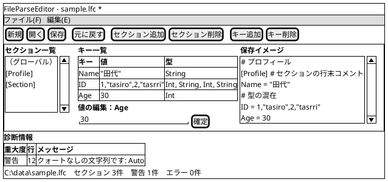

## 2. ダイアログのレイアウト（基本設計書 3-5）

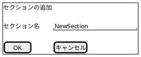

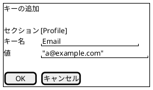

## 3. 画面遷移図（基本設計書 3-6）

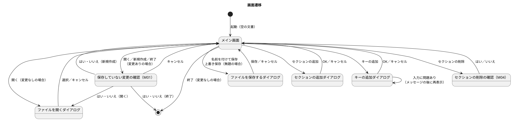

## 4. クラス図（基本設計書 7-3・7-4）

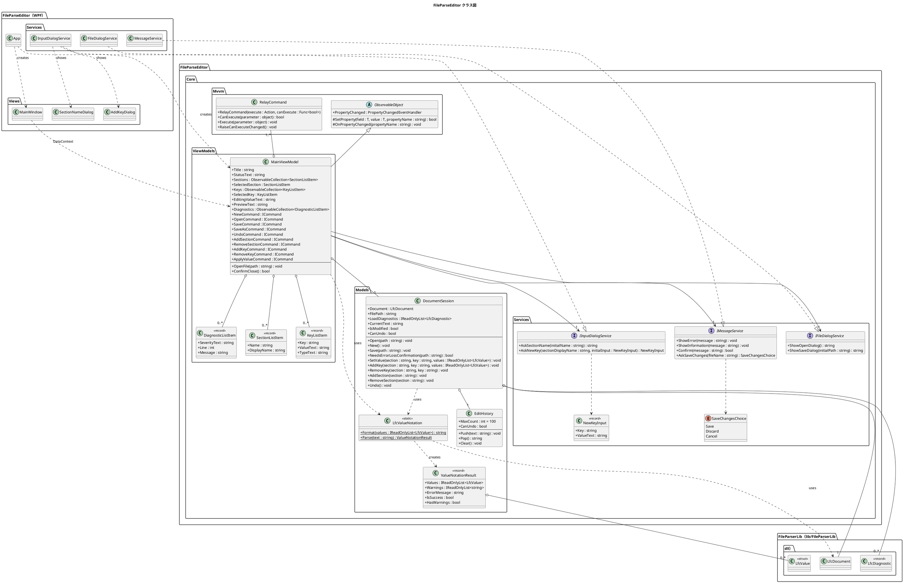

## 5. シーケンス図（ファイルを開く）（基本設計書 8-1）

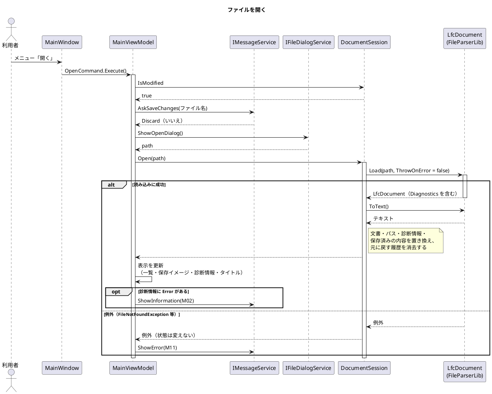

## 6. シーケンス図（値の変更）（基本設計書 8-2）

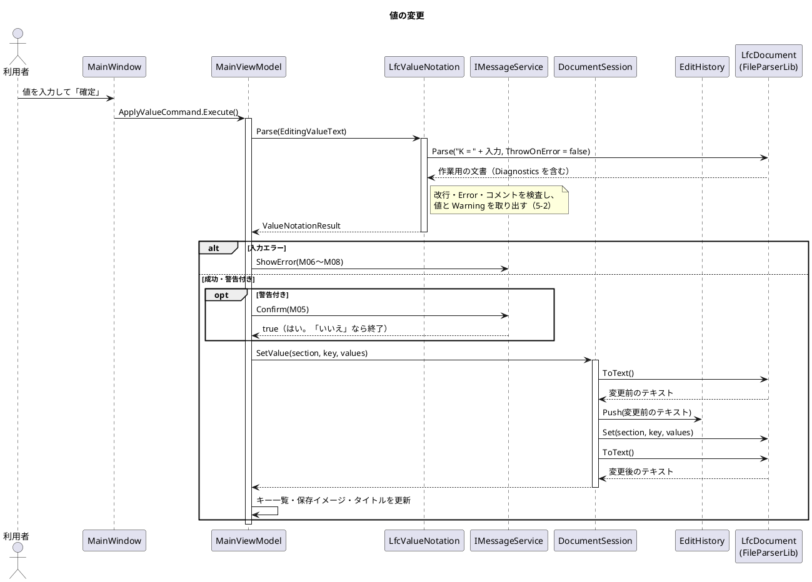

## 7. シーケンス図（元に戻す）（基本設計書 8-3）

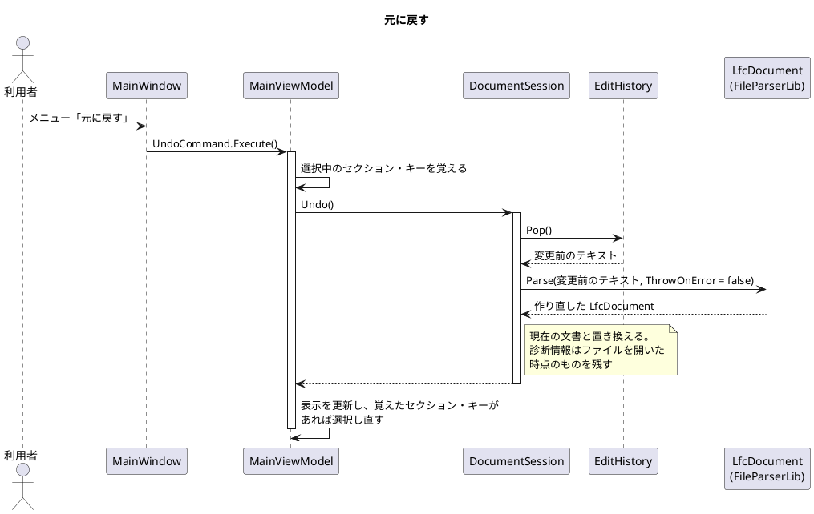

## 8. シーケンス図（上書き保存：エラーを含むファイル）（基本設計書 8-4）

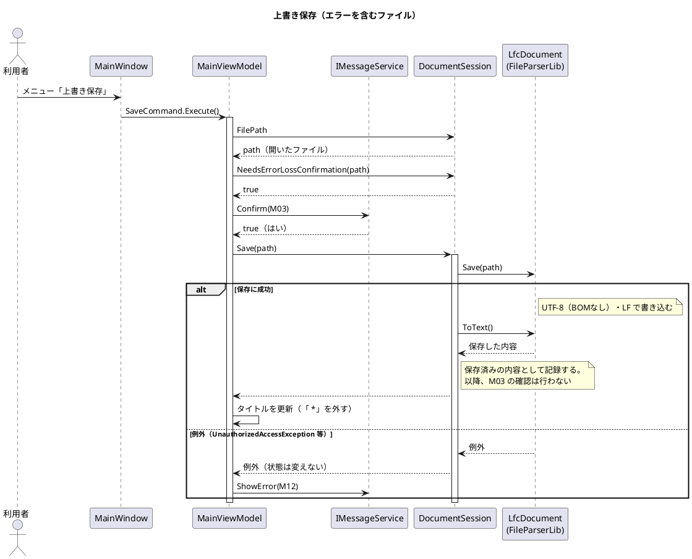

## 9. アクティビティ図（値の入力の解釈）（基本設計書 5-2）

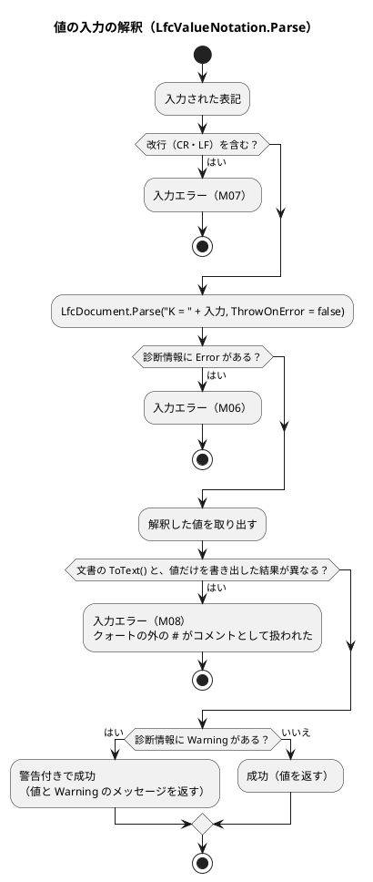

## 10. アクティビティ図（保存していない変更の確認）（基本設計書 6-10）

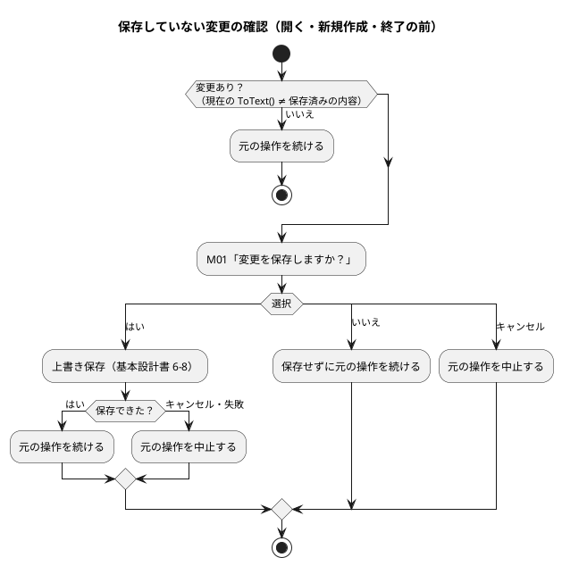
